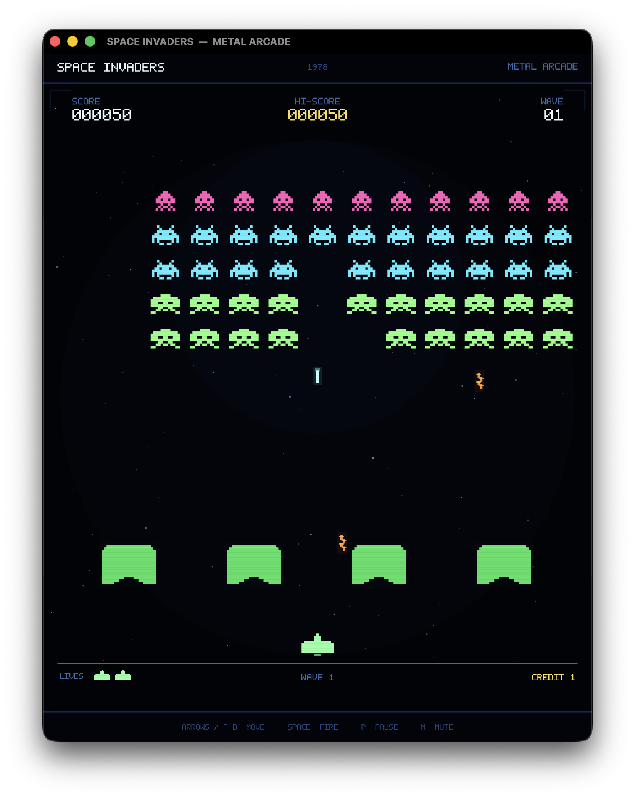

# SPACE INVADERS — Metal Arcade

A complete, native macOS tribute to the 1978 fixed shooter, written from scratch in Swift and rendered entirely with Metal. There are no sprite sheets, no game engine, no audio files, and no runtime downloads: the invaders, cannon, mystery ship, bunkers, starfield, pixel font, app icon, and chip-style sound effects are all generated procedurally.

Canonical source: <https://github.com/dlcmh/1978-space-invaders-in-swift-on-macos>



## Play

From a fresh clone:

```bash
git clone https://github.com/dlcmh/1978-space-invaders-in-swift-on-macos.git
cd 1978-space-invaders-in-swift-on-macos
make app
open "dist/SPACE INVADERS.app"
```

To produce a distributable disk image as well:

```bash
make dmg
# dist/SPACE-INVADERS-1.0.dmg
```

Generated bundles under `dist/` are intentionally not committed. For development with Swift Package Manager:

```bash
make run
```

Requires macOS 13 or newer and a Mac with Metal support. The project builds with the Swift toolchain included in Xcode or the Command Line Tools.

## Controls

| Key | Action |
| --- | --- |
| Left / Right, A / D | Move the laser cannon |
| Space | Fire (one shot in flight, as in 1978) |
| Return / Space | Start game / play again |
| P | Pause / resume |
| Esc | Pause |
| M | Mute / unmute |
| ⌘N | New game |
| ⌘P / ⌘M | Pause / mute (menu shortcuts) |
| ⌃⌘F | Toggle full screen |

The window is resizable and keeps the portrait arcade aspect ratio. Sound can be muted at any time and the setting is remembered.

## What is implemented

- The original **224 × 256 portrait playfield**, scaled crisply to the window.
- **55 invaders in five rows of eleven**: squid on the top row, crabs in the middle, octopus at the bottom. Each has two procedural animation frames and is worth **30, 20, or 10 points**.
- The classic formation march: two pixels sideways per step, an eight-pixel drop whenever the edge is reached, and a direction reversal after every drop.
- **Acceleration as the formation thins out**, plus a faster starting tempo on later waves. The remaining invaders really do move faster, preserving the feel of the original hardware's decreasing processor load.
- A player cannon with continuous horizontal movement and the original **one-shot-in-flight** restriction.
- **Four destructible bunkers**, each a 22 × 16 cell shield. Player shots and enemy bombs bite small irregular holes; descending invaders erase the cells they touch. A new wave restores them.
- Enemy bombs dropped by the lowest surviving invader in a column, up to three in flight at once.
- The **Mystery Ship**, crossing above the formation for **50, 100, 150, or 300 points**.
- Scoring, a persistent high score, three cannons, a bonus cannon at **1,000 points** and every **5,000 points** after that, wave progression, death animation, pause, and game over.
- Attract, ready, playing, player-dying, wave-clear, and game-over states.
- A **single-draw-call Metal renderer** with 4× MSAA, original procedural pixel art, a custom 5 × 7 font, neon glows, sky stars, CRT scanlines, and an arcade cabinet frame.
- Procedural chip-style audio generated at launch with AVAudioEngine, including the four-note marching bass loop.

## Project layout

```
Sources/SpaceInvadersCore/     Pure Swift simulation (Foundation only)
  Arena.swift                  224 × 256 constants, entity types, events
  Bunker.swift                 Destructible 22 × 16 shield grid
  Game.swift                   Formation march, shots, bombs, UFO, waves, scoring
  Math.swift                   Vectors, rectangles, deterministic RNG
Sources/SpaceInvadersArcade/   macOS executable
  AppDelegate.swift            Window, application menu
  GameView.swift               MTKView, fixed-step loop, keyboard input, persistence
  Renderer.swift               Scene composition, HUD, overlays, procedural art
  SpriteArt.swift              Hand-built invader, cannon, and UFO bitmaps
  Canvas.swift                 Immediate-mode triangle primitives
  PixelFont.swift              5 × 7 vector-pixel font
  MetalShaders.swift           Inline Metal shaders
  SoundEngine.swift            Procedurally synthesized sound effects
Checks/                        Dependency-free simulation checks
scripts/                       App bundle, icon generation, documentation checks, gate
Resources/                     Info.plist and generated app icon
Docs/                          Screenshots, project origin, Metal course, Q&A, refactoring
AGENTS.md                      Operating instructions for coding agents
CONTRIBUTING.md                Contribution workflow and quality bar
GOVERNANCE.md                  Decision-making, release, and IP policy
SECURITY.md                    Vulnerability reporting and privacy posture
```

The simulation is deliberately independent of AppKit and Metal so it can be exercised headlessly by `SpaceInvadersChecks`.

## Verification

```bash
make check
```

`make check` is the gate every change must pass: `swift-format lint`, a release build with `-warnings-as-errors`, the simulation checks, and `make docs-check`. Formatting follows [`.swift-format`](.swift-format) (4-space indent, 100 columns); apply it with:

```bash
xcrun swift-format format --in-place --recursive Sources Checks
```

The checks alone are available as `make checks`.

The suite covers playfield dimensions, the 55-invader formation and point values, cannon rail limits, firing and the one-shot limit, projectile collision, bunker damage, pause behavior, mystery-ship appearance, bomb hits and life loss, game over and restart, a 60-second movement soak test, and a **wave-clear autopilot** that destroys all 55 invaders, survives the bomb stream, advances to wave 2, and verifies that the new formation and bunkers are restored. The current baseline passes **23,116 checks**.

## New to Metal?

If you have never written a GPU API, the [Metal crash course](Docs/METAL_CRASH_COURSE.md) starts from "what is the GPU actually doing?" and walks through this renderer's shaders, vertex buffer, single draw call, blending, and MSAA using the actual source. It assumes no Metal or graphics knowledge and uses familiar web-development analogies.

## Questions and answers

[`Docs/QnA/`](Docs/QnA/README.md) collects source-grounded answers to individual questions about how the game works: the headless core, the march-and-acceleration model, destructible bunkers, the CPU/GPU split, and the mystery ship. Each entry links to the files and symbols it describes.

## Refactoring

[`Docs/Refactoring/`](Docs/Refactoring/README.md) holds dated records of refactors that were proposed and evaluated. The first entry explains why the formation is stepped as **one unit** rather than as 55 independent invaders, and what that choice buys in determinism and checkability.

## Project and governance

- [Project origin](Docs/PROJECT_ORIGIN.md) — the original commission, scope decisions, and delivery record
- [Contributing](CONTRIBUTING.md)
- [Governance](GOVERNANCE.md)
- [Security policy](SECURITY.md)
- [Agent instructions](AGENTS.md)

No open-source license has been selected for this repository; see the governance policy before reusing or redistributing any part of it.

## Notes

SPACE INVADERS is a trademark of TAITO CORPORATION. This is a fan-made, non-commercial technical tribute and is not affiliated with or endorsed by Taito or Midway. All artwork, audio, and code in this repository are original procedural work. The historical details in the brief — Tomohiro Nishikado, Taito's 1978 Japanese release, Midway's overseas distribution, the 55 invaders, the four bunkers, and the load-driven speed-up — are treated as design context and honoured in the implementation.
